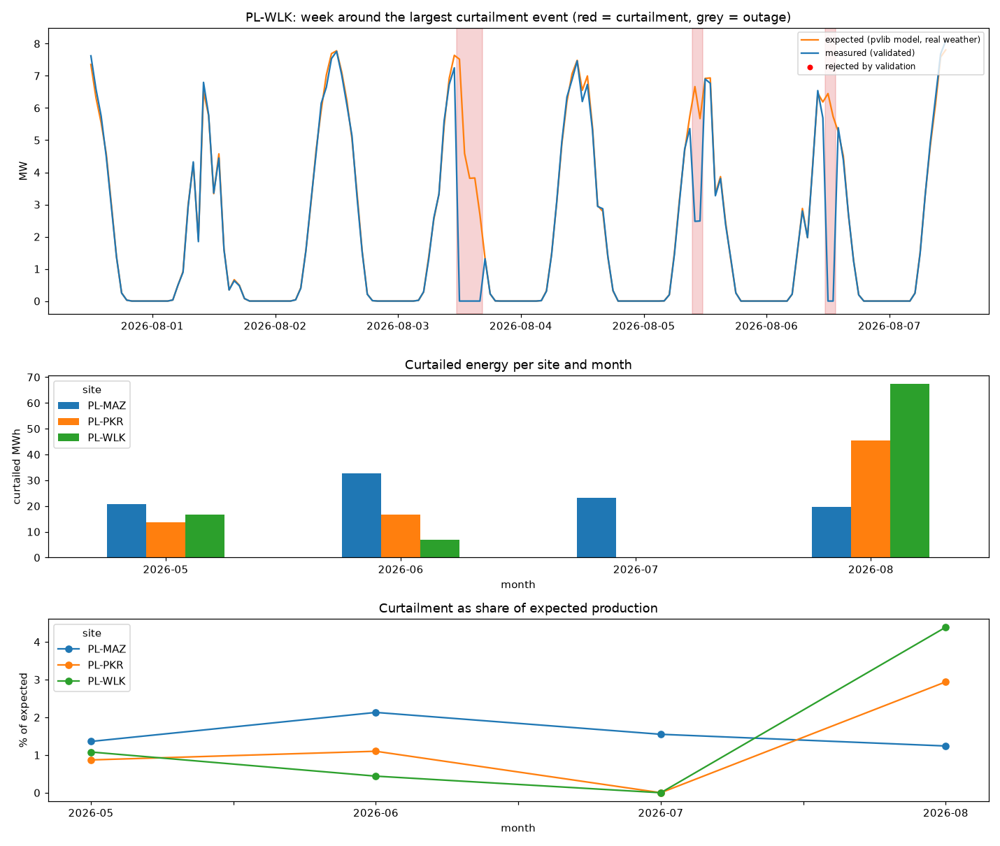

# PV curtailment analyzer: collect, consolidate, validate, quantify

A small grid-operations workstream for three solar plants in Poland (May to August 2026): pull real weather, model what each plant should have produced, consolidate plant data that arrives in three different country formats, validate it, separate **grid curtailment** from **equipment outages**, and report the lost energy per site and month.



## What is real and what is simulated

| | Source |
|---|---|
| Weather (irradiance, temperature, wind), hourly | **Real**: Open-Meteo historical archive, three locations in Mazowieckie, Wielkopolskie and Podkarpackie |
| Expected plant output | **Modelled** with pvlib: 10 MWp fixed tilt, Hay-Davies transposition, Faiman cell temperature, PVWatts DC and inverter (8.3 MW AC) |
| "Measured" plant data and inverter availability | **Simulated** from the expected output, with injected grid curtailment (setpoint caps at 0, 30, 50, 70 %), one-inverter outages and data defects |

Simulating the plant data on purpose gives a **ground truth**, so every detection can be scored instead of trusted.

## Pipeline (`src/pipeline.py`, run with `python run_all.py`)

1. **Collect**: hourly weather per site, cached in `data/`.
2. **Model**: expected AC output from irradiance and temperature.
3. **Consolidate**: three country feeds in different formats, as inputs from several country managers would arrive:
   * Mazowieckie: MW, UTC, English headers
   * Wielkopolskie: kW, local Warsaw time, Polish headers (`Moc czynna [kW]`, `Falowniki online`), semicolon CSV with decimal commas
   * Podkarpackie: % of AC rating and availability %, ISO timestamps
   
   All are brought to one schema: UTC hour-ending index, `measured_mw`, `inv_online` (`data/country_feeds/` holds the raw files).
4. **Validate**: every hour is flagged for missing, duplicate, out-of-range, night generation, or frozen sensor (the same non-zero value for 3+ hours while expected output moves).
5. **Detect**: hours clearly below expected are split into
   * **outage**: an inverter is reported offline (availability loss),
   * **curtailment**: output held on a flat plateau (setpoint) or at zero export with all inverters online,
   * **unclassified**: anything else, left for a human to check.
6. **Report**: monthly curtailed MWh, % of expected, estimated value, outage loss and data quality ([results/report.md](results/report.md), [results/monthly_summary.csv](results/monthly_summary.csv), [results/events.csv](results/events.csv)).

## Results (scored against the injected ground truth)

| Site | Curtailment events | Detected | False alarms | Lost MWh (true) | Lost MWh (estimated) | Outages found |
|---|---|---|---|---|---|---|
| PL-MAZ | 10 | 9 | 0 | 96.9 | 96.5 | 2 / 2 |
| PL-WLK | 9 | 8 | 0 | 104.1 | 91.1 | 2 / 2 |
| PL-PKR | 13 | 13 | 0 | 76.9 | 75.7 | 2 / 2 |

* 30 of 32 curtailment events detected, no false alarms, every outage separated from curtailment.
* Curtailed energy estimated within 0.4 % and 1.6 % at two sites. At PL-WLK it is 12 % low: one curtailment fell on a day with an inverter outage, and those hours were booked as availability loss.
* Validation rejected all injected spikes, duplicates and night readings, and both daytime frozen sensors (about 1 % of hours per site).

## What went wrong on the way (and what it taught me)

1. **A frozen sensor looked like a grid curtailment.** A meter froze at 0.16 MW one morning; the flat line passed as a setpoint cap, because my first frozen-sensor rule ignored low values. Now any identical non-zero value repeated for 3+ hours while the expected output moves is rejected, and an exact zero plateau is kept as possible zero export.
2. **Power data alone cannot tell a 70 % setpoint from a lost inverter.** When the inverters are clipping at midday, expected output is flat, so "75 % of a flat line" looks exactly like a setpoint. My power-only detector either raised false alarms or missed 70 % caps. The fix is the same one operators use: bring in the **inverter availability** signal from SCADA, which is also how O&M contracts separate availability loss from curtailment.
3. **Edge of the reporting period.** Converting hour-ending UTC timestamps to local time created an empty "September" row; months without production are now dropped.

## Limitations

* Plant data are simulated; on a real portfolio the curtailment instruction log from the grid operator (redispatch orders) would confirm or replace the plateau detection.
* Hourly resolution: real SCADA data at 1 to 15 minutes would sharpen event boundaries.
* Value of curtailed energy uses one assumed price (60 EUR/MWh); a real report would use the day-ahead price for each hour and the compensation rules that apply.

## Run

```bash
python -m venv .venv && .venv/bin/pip install -r requirements.txt
.venv/bin/python run_all.py      # downloads weather on first run, about 30 s afterwards
```

**Author:** Saadna Ilyes, final-year engineering student, Industrial Networks & AI, Higher National School of Renewable Energies (HNSREED, Batna) · [GitHub](https://github.com/ilyessaadna10) · [LinkedIn](https://linkedin.com/in/ilyes-saadna) · ilyessaadna4@gmail.com
